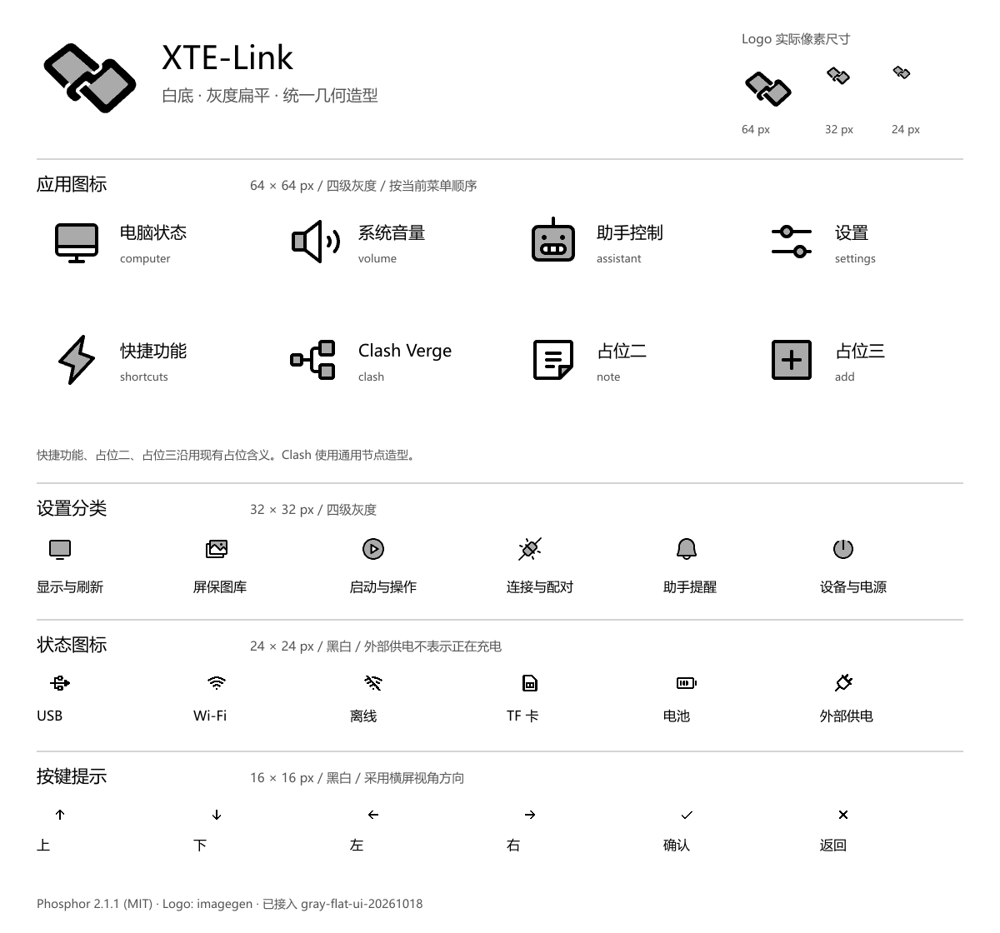

# XTE-Link 灰度扁平图标 · v1

按 2026-10-18 确认的方向制作：**白色背景、适合灰度显示的扁平画风、统一视觉语言**。



## 本版内容

- 8 枚 64×64 菜单图标：电脑状态、系统音量、助手控制、设置、快捷功能、Clash Verge、占位二、占位三。
- 6 枚 32×32 设置分类图标：显示与刷新、屏保图库、启动与操作、连接与配对、助手提醒、设备与电源。
- 6 枚 24×24 状态图标：USB、Wi-Fi、离线、TF 卡、电池、外部供电。
- 6 枚 16×16 横屏按键符号：↑、↓、←、→、✓、×。
- 一个“两块屏幕相扣”的小 Logo，导出 128、64、32、24 像素版本。

主图标采用黑色轮廓、浅灰色块和白色留白；栅格导出限定为 0/85/170/255 四级灰度，无抖动。
小号状态及按键采用同一图标家族的 bold 字重，导出为黑白，保留小尺寸对比度。
TF 图标复用卡片形状 `sim-card`，表示存储卡；不引入蜂窝网络含义。
外部供电使用插头，不表示正在充电或已经充满。电池图标只是造型素材，接入时仍须保留实时电量绘制。
Clash 使用通用节点图形，不冒充 Clash Verge 官方品牌标志。
三个占位入口只提供与当前菜单对应的造型，不新增功能。

## 文件与使用边界

| 文件夹 / 文件 | 用途 |
| --- | --- |
| `png/` | 与 BMP 像素一致的白底预览；尺寸已固定 |
| `svg/` | 适配后的矢量图标源文件；灰色块来自原双层图形 |
| `tf/xte-link/ui/gray-flat-v1/` | 可存入 TF 卡的独立 BMP；文件名含像素尺寸 |
| `originals/logo-imagegen.png` | 内置 imagegen 生成的 Logo 原图，不是矢量稿 |
| `sources/phosphor/` | 固定 commit 的上游 SVG 原件及 MIT 许可 |
| `manifest.json` | 图标用途、上游名称、尺寸、位深、目标路径、摘要 |
| `PROMPTS.md` | Logo 生成与调整的完整提示词 |
| `SHA256SUMS.txt` | 本目录各文件 SHA-256，不含摘要文件自身 |

TF 目录映射示例：`tf/xte-link/ui/gray-flat-v1/computer-64.bmp` → 卡上 `/xte-link/ui/gray-flat-v1/computer-64.bmp`。
文件均为未压缩调色板 BMP；菜单、设置及 Logo 为 4 bpp，状态和按键为 1 bpp，行按 4 字节对齐。

**已接入 `gray-flat-ui-20261018` 并刷入当前验证设备。** 30 个 BMP 已上传 TF 且全部读回校验一致，原有屏保图库保留。
页头 Logo、两页菜单、设置分类、连接/供电状态与方向符号已接线；实时电量继续动态绘制，不采用静态电池素材。
固件复用现有 `SleepImage` 的调色板 BMP 读取器，新增小尺寸绘制；灰度沿用 SDK 接口。
绘制后在同一帧缓冲内重建黑白基线，恢复差分刷新，不分配第二个整屏缓冲；素材缺失或损坏时回退旧图标。
启动日志确认 13 项素材加载、零缺失并完成灰度刷新。总览仍是电脑预览；真实屏幕的观感、连续操作与残影需实体设备验收。
方向符号采用横屏视角，SDK 键名与映射保持现有约定。

## 来源与复现

图标复用 [Phosphor Icons core](https://github.com/phosphor-icons/core)，版本 **2.1.1**，
commit **`2b75f3ad12b420c9504ef05df8d2564a28f8500e`**，MIT 许可。
菜单与设置取 duotone 字重，将次层不透明度从 0.2 调到 1/3，使白底次层为 170 灰；状态与按键取 bold 字重。
上游完整许可保留在 `sources/phosphor/LICENSE`。图标库不是设备运行依赖。
Logo 使用内置 imagegen 生成，完整提示词见 `PROMPTS.md`；未调用外部 API CLI。
小尺寸导出收紧生成原图的外部留白，使 Logo 与图标的视觉尺寸接近，保持原有相扣造型。

`export.cjs` 使用 Node.js 和 sharp（实际版本记在 manifest）。在已有 sharp 的开发环境运行：

```powershell
node assets/ui/gray-flat-v1/export.cjs
```

默认仅使用本目录已保存的原图和 SVG，离线导出；首次缺少上游文件时可用 `--fetch` 从固定 commit 下载。
修改素材说明后重新运行可更新完整摘要。导出不会访问串口、TF 或固件构建流程。
